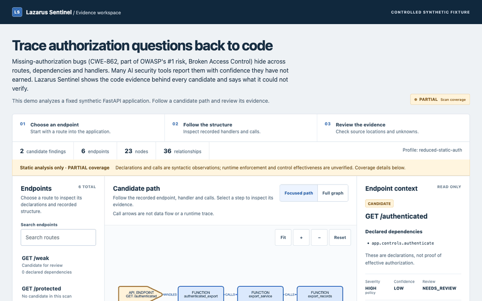
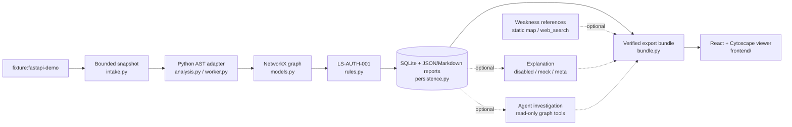

<div align="center">

# Lazarus Sentinel

**An AI security assistant that can only cite evidence that exists.**
Graph-first, read-only application-security analysis. Every candidate traces back to code, and every evidence ID the AI cites must come from that trace.

[](https://github.com/sumitjadhav1703/Lazarus_Sentinel/actions/workflows/ci.yml)
[](LICENSE)


[Live demo](https://sumitjadhav1703.github.io/Lazarus_Sentinel/) · [Quickstart](#quickstart) · [How it works](#how-it-works) · [Roadmap](#roadmap) · [Contributing](#contributing) · [Docs](#documentation)

</div>

---

## The problem

Missing-authorization bugs ([CWE-862](https://cwe.mitre.org/data/definitions/862.html), part of OWASP's #1 risk, [Broken Access Control](https://top10.owasp.org/2025/A01_2025-Broken_Access_Control/)) hide across routes, dependencies and handlers. A reviewer has to follow a request from the route, through its handler and calls, to the sensitive operation. They also need to know what the tool could not see. Many AI security tools skip that and report findings with confidence they have not earned.

Lazarus Sentinel builds a deterministic graph of the code and flags *candidates*, never confirmed vulnerabilities. It shows the exact source evidence and lists what it could not verify. Meta's Muse Spark explains and investigates a candidate using that evidence's metadata. Any evidence ID the model cites that cannot be traced back to the graph is rejected. The checks cover citation IDs, not whether each sentence of the model's prose is correct, so the prose stays UNREVIEWED notes for a human.

> **What to look at in 60 seconds**
> 1. Open the [live demo](https://sumitjadhav1703.github.io/Lazarus_Sentinel/) and select **GET /authenticated**.
> 2. Follow the candidate path from the route to `export_records`, and select a step to see its file and lines.
> 3. Read **Weakness references** (CWE-862, OWASP A01), then expand **Recorded live explanation** from Muse Spark 1.3.
> 4. Select **GET /protected**: a declared dependency is shown as a declaration, *not* proof of enforcement.



> **Honest scope.** The shipped release scans a **controlled synthetic FastAPI fixture**. It is not an arbitrary-repository security audit. A finding is a *candidate for human review*, never a confirmed vulnerability.

## Table of contents

- [What it is, and is not](#what-it-is-and-is-not)
- [Current status](#current-status)
- [Quickstart](#quickstart)
- [How it works](#how-it-works)
- [Using the CLI](#using-the-cli)
- [Viewer](#viewer)
- [Optional API credential](#optional-api-credential)
- [Quality checks](#quality-checks)
- [Roadmap](#roadmap)
- [Contributing](#contributing)
- [Documentation](#documentation)
- [Boundaries and safety](#boundaries-and-safety)
- [License](#license)

## What it is, and is not

| It is | It is not |
|---|---|
| Static, read-only analysis of owned, fixed fixtures | A scanner for arbitrary repositories or live sites |
| Deterministic, hash-linked evidence (file, lines, analyzer, rule) | An LLM guess: the model may explain and investigate evidence, but never invent it |
| Explicit about `unknown`, `unresolved` and `unsupported` | A claim of a complete graph or of proven security |
| Severity, confidence and coverage kept separate | An exploit tool or auto-remediator |

## Current status

| Capability | Status |
|---|---|
| Intake | Fixed `fixture:fastapi-demo` identifier; manifest-bounded, read-only source parsing |
| Analysis | Python AST structure plus supported literal FastAPI routes and dependencies; no target imports or execution |
| Graph | Schema 0.1.0, deterministic identities, NetworkX MultiDiGraph, source hashes and locations |
| Rule | `LS-AUTH-001`: LOW-confidence declaration-gap candidates, mapped to CWE-862 and OWASP A01. Opaque controls are diagnostics only. |
| Persistence / report | SQLite committed references; graph, findings and coverage JSON; escaped Markdown |
| Measured demo | 6 endpoints, 23 nodes, 36 edges, 2 candidates, 3 matching declarations with effectiveness unverified |
| Meta explanation | One validated live Muse Spark 1.3 explanation, recorded and replayed in the public viewer |
| Agent investigation | Muse Spark calls read-only graph tools step by step, and every step is replayed on load. **Built and tested offline. The live run is pending review.** See [spec/10](spec/10_AGENT_INVESTIGATION.md). |
| Weakness references | Reviewed CWE/OWASP links per rule, with an optional refresh through Meta's built-in `web_search` (allowlisted hosts only). **Live search pending review.** |
| Quality | [Native Windows, macOS and Linux CI](docs/23_PORTABILITY_AND_RELEASE_VERIFICATION.md); on macOS, measured 2026-11-04: 245 backend tests passed and 4 skipped (optional-extra or Windows-only tests); 29 frontend tests passed |
| Controlled assessments | Separate fixed-fixture DATA, TRUST and actor/action/resource reports |
| Optional workflow | LangGraph over the fixed demo stages. See [orchestration](docs/05_ORCHESTRATION.md). |
| Blocked / deferred | Joern, canonical DATA/TRUST graph integration, HTTP API, durable review, arbitrary repositories, OS isolation |

The fixture intentionally contains unsupported dynamic registration, so its normal outcome is **PARTIAL / exit 2**. A matching authorization declaration is syntax evidence, not proof of enforcement.

For the deadline checklist and costs, read the [submission and cost plan](spec/07_SUBMISSION_AND_COST_PLAN.md). [Competition verification](spec/06_COMPETITION_VERIFICATION.md) covers the live annotation, the bounded assessment results and the demo limitations.

## Quickstart

Prerequisites: [Git](https://git-scm.com), [uv](https://docs.astral.sh/uv/), and Node.js 24 with npm. `uv` selects Python 3.13 from `.python-version`. No global packages or API keys are needed. The commands work the same in macOS and Linux terminals and in Windows PowerShell.

```sh
git clone https://github.com/sumitjadhav1703/Lazarus_Sentinel.git
cd Lazarus_Sentinel
uv sync --project backend --locked
uv run --project backend --locked lazarus scan --target fixture:fastapi-demo
```

> **Exit code 2 is expected here.** 0 = completed with no relevant coverage gaps, 2 = useful partial output, 1 = failure. stdout is one JSON summary.

Artifacts are written to `artifacts/scans/<scan_id>/{graph.json,findings.json,coverage.json,report.md}`, with metadata in `artifacts/sentinel.sqlite3`. Repeated scans never overwrite each other. Evidence stores relative locations and hashes, not raw source excerpts.

Install dependencies once. This needs network access to the uv and npm registries:

```sh
uv sync --project backend --locked
npm ci --prefix frontend --ignore-scripts --no-audit --no-fund
```

Then run the full verification. This step makes no network or model calls and needs no API key:

```sh
uv run --project backend --locked python scripts/verify_demo.py
```

For a fresh mock explanation bundle and a short walkthrough, see the [demo closeout guide](spec/05_DEMO_CLOSEOUT.md).

## How it works



| Area | Files |
|---|---|
| CLI and coordination | `backend/src/lazarus_sentinel/cli.py`, `service.py` |
| Intake and extraction | `intake.py`, `worker.py`, `analysis.py` |
| Canonical facts | `models.py`, `rules.py` |
| Artifacts | `persistence.py`, `bundle.py`, `demo_models.py` |
| Meta boundary | `explanations.py`, `investigation.py`, `references.py`, `meta_provider.py`, `budget.py` |
| Viewer | `frontend/src/`, with fixed assets in `frontend/public/demo/v1/` |
| Reproduction | `scripts/verify_demo.py`, `prepare_demo.py`, `inspect_artifacts.py` |

Backend Pydantic schemas are authoritative. `CALLS` is not data flow, and `DEPENDS_ON` is not enforcement. See [architecture](docs/02_ARCHITECTURE.md) and [graph schema](docs/03_GRAPH_SCHEMA.md).

**How the agent is kept honest.** The investigation tools are pure lookups in the committed graph: `get_finding`, `get_node`, `get_neighbors`, `get_evidence`, `list_endpoints` and `get_coverage`. The run ends with `submit_investigation`. No source text, files or network are reachable. Every recorded step is re-run when the bundle is verified and must match exactly. A citation counts only if a tool returned it for this finding. A malformed turn ends the run with no retry and no partial record.

## Using the CLI

```sh
uv run --project backend --locked lazarus --help
uv run --project backend --locked lazarus explain --scan-id <SCAN_UUID> --finding-id <FINDING_ID> --provider mock
uv run --project backend --locked lazarus investigate --scan-id <SCAN_UUID> --finding-id <FINDING_ID> --provider mock
uv run --project backend --locked lazarus references --rule-id LS-AUTH-001 --provider mock
uv run --project backend --locked lazarus demo export --scan-id <SCAN_UUID> --annotation-id <ANNOTATION_UUID> --investigation-id <INVESTIGATION_UUID> --references-id <REFERENCE_UUID>
```

Use the IDs your own scan returns; finding IDs are in its `findings.json`. `explain`, `investigate` and `references` default to **DISABLED**. Mock output is offline, unreviewed assistance and never changes canonical findings. The `meta` provider needs explicit selection and `MODEL_API_KEY`.

There are two budget ledgers:
- **Explanations:** the shared USD 3 / five-attempt ledger.
- **Investigations and web-search references:** a separate ledger capped at 20 calls and USD 1.

Both ledgers fail closed.

## Viewer

```sh
npm ci --prefix frontend --ignore-scripts --no-audit --no-fund
npm run dev --prefix frontend
```

Open the loopback URL Vite prints. The viewer loads only the reviewed synthetic bundle in `frontend/public/demo/v1/`:
- Search for an endpoint, inspect a focused path, or switch to the full graph.
- Select a node to see its source evidence and its weakness references.
- When a bundle includes an investigation, select one of its steps to highlight the node that step looked at.

Fit, zoom and reset controls, keyboard step controls and expandable identity tables support deeper review. There is no upload, source path input or HTTP backend. Details: [viewer design and verification](docs/20_VIEWER_CLARITY_AND_DESIGN.md).

The shipped dataset uses scan `8f48abe7-df1b-44fa-b821-0bc3075c882f` and bundle `86700a21-649c-43da-bfc0-6253d5dfaa1d`, with a recorded live Meta annotation. Generated reports are historical evidence: create new scan identities instead of editing old ones.

## Optional API credential

You don't need a credential for scans, the viewer, or disabled and mock assistance. To prepare a local key file, copy [.env.example](.env.example) to `.env` once (`cp .env.example .env`, or `Copy-Item .env.example .env` in PowerShell) and fill in `MODEL_API_KEY`.
- `.env` is Git-ignored.
- The backend reads `MODEL_API_KEY`, not `META_API_KEY`.
- The CLI does not load `.env` automatically. Pass `uv run --env-file .env ...` when you choose to.

Creating the file does not enable live calls. Keep credentials out of the frontend and out of all `VITE_*` variables.

## Quality checks

```sh
uv run --project backend --locked pytest backend/tests
uv run --project backend --locked ruff check backend/src backend/tests
uv run --project backend --locked ruff format --check backend/src backend/tests
uv run --project backend --locked mypy --config-file backend/pyproject.toml backend/src
npm --prefix frontend run typecheck && npm --prefix frontend run lint && npm --prefix frontend test
```

CI runs these as separate jobs on every pull request and on pushes to `main`. It also runs a 3-OS (macOS, Windows, Linux) offline verification and CodeQL. If a restricted environment cannot use the shared uv cache, see [document 21](docs/21_TEAM_HANDOFF.md).

## Roadmap

Planned work is tracked as [GitHub issues](https://github.com/sumitjadhav1703/Lazarus_Sentinel/issues) (labels `roadmap`, `good first issue`, `help wanted`). Gated plan: [next-phase plan](docs/22_NEXT_PHASE_PLAN.md) and [spec](spec/README.md).

- [ ] P03 fresh-clone reproduction on a second machine
- [ ] P04 accessibility feedback round
- [ ] P05 measure and, if justified, split the viewer chunk
- [x] P07 one validated, authorized live Meta explanation export
- [x] Offline agent investigation and weakness references ([spec/10](spec/10_AGENT_INVESTIGATION.md))
- [ ] Reviewed live agent investigation and web-search reference record
- [ ] P08 reviewed sandbox runtime with denial probes
- [ ] P09 bounded next-intake contract, optional Joern spike, `LS-DATA-001` / `LS-TRUST-001`
- [x] P10 public demo on GitHub Pages
- [x] S01 semantic contract for the next analysis stage

## Contributing

New here? Start with issues labelled [`good first issue`](https://github.com/sumitjadhav1703/Lazarus_Sentinel/labels/good%20first%20issue).
1. Read [CONTRIBUTING.md](CONTRIBUTING.md) and the [team handoff](docs/21_TEAM_HANDOFF.md).
2. Branch from `main` and run `scripts/verify_demo.py`.
3. Open a PR using the template.

Report vulnerabilities privately as described in [SECURITY.md](SECURITY.md). Participation is governed by the [Code of Conduct](CODE_OF_CONDUCT.md).

## Documentation

- Start: [team handoff](docs/21_TEAM_HANDOFF.md), [contributing](CONTRIBUTING.md), [task board](TASK_BOARD.md), [live log](AGENT.md), [platform evidence](docs/23_PORTABILITY_AND_RELEASE_VERIFICATION.md), [CI and issue backlog](docs/24_CONTRIBUTOR_READINESS_AND_CI.md).
- Contracts: [first slice](docs/13_FIRST_SLICE_CONTRACT.md), [demo delivery](docs/16_DEMO_DELIVERY_CONTRACT.md), [agent investigation](spec/10_AGENT_INVESTIGATION.md), [implementation review](docs/14_IMPLEMENTATION_REVIEW.md), [next steps](docs/15_NEXT_STEPS.md).
- Evidence: [capability report](docs/17_CAPABILITY_AND_RESEARCH_REPORT.md), [evaluation](docs/18_DEMO_EVALUATION.md), [integrated review](docs/19_INTEGRATED_DEMO_REVIEW.md).
- Reference: [00 Charter](docs/00_PROJECT_CHARTER.md), [01 Requirements](docs/01_REQUIREMENTS.md), [02 Architecture](docs/02_ARCHITECTURE.md), [03 Graph schema](docs/03_GRAPH_SCHEMA.md), [04 Rules](docs/04_ANALYSIS_RULES.md), [05 Orchestration](docs/05_ORCHESTRATION.md), [06 API/persistence](docs/06_API_AND_PERSISTENCE.md), [07 Frontend](docs/07_FRONTEND.md), [08 Security](docs/08_SECURITY_MODEL.md), [09 Evaluation](docs/09_TESTING_EVALUATION.md), [10 Roadmap](docs/10_IMPLEMENTATION_PLAN.md), [11 Decisions](docs/11_DECISIONS_AND_ASSUMPTIONS.md), [12 Sources](docs/12_SOURCES.md).
- Blueprint audit and next stage: [spec/](spec/README.md).
- AI-agent workflow (maintainers): [AGENTS.md](AGENTS.md), [CLAUDE.md](CLAUDE.md), [CODEX_BOOTSTRAP_PROMPT.md](CODEX_BOOTSTRAP_PROMPT.md).

## Boundaries and safety

- **Intake:** only the fixed owned fixture is accepted. Caps are 100 Python files, 256 KiB per file and 5 MiB in total.
- **Parser:** a credential-free child process with a 30-second deadline reads source without executing target code. Hostile concurrent filesystem replacement is out of scope.
- **Not a sandbox:** these are process and input limits, **not an OS filesystem or network sandbox**. Runtime security remains unverified.
- **What leaves the machine:**
  - The live explanation and investigation send synthetic evidence metadata: IDs, names, paths, line ranges and hashes. They never send source text.
  - Web-search references send only a fixed per-rule question, and keep only citations on `cwe.mitre.org` and `owasp.org`.
- **Not yet available:** Joern remains NOT_ATTEMPTED, and DATA/TRUST run as separate controlled assessments.

Only analyze code you own or are authorized to assess.

## License

[Apache License 2.0](LICENSE). Copyright 2026 Sumit Jadhav and Lazarus Sentinel contributors; see [NOTICE](NOTICE). Third-party dependencies keep their own licenses.
