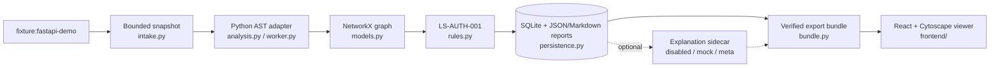

<div align="center">

# Lazarus Sentinel

**Graph-first, evidence-backed application-security analysis.**
Correlate program structure with endpoints, permissions and trust boundaries, and get reproducible, human-reviewable findings. Defensive and read-only.

[](https://github.com/sumitjadhav1703/Lazarus_Sentinel/actions/workflows/ci.yml)


[Quickstart](#quickstart) · [How it works](#how-it-works) · [Roadmap](#roadmap) · [Contributing](#contributing) · [Docs](#documentation)

</div>

---

> **Honest scope.** The shipped release is a **controlled synthetic FastAPI fixture scanner**, not an arbitrary-repository security audit. A finding is a *candidate for human review*, never a confirmed vulnerability.

## Table of contents

- [What it is, and is not](#what-it-is-and-is-not)
- [Current status](#current-status)
- [Quickstart](#quickstart)
- [How it works](#how-it-works)
- [Using the CLI](#using-the-cli)
- [Viewer](#viewer)
- [Optional API credential](#optional-api-credential)
- [Quality checks](#quality-checks)
- [Roadmap](#roadmap)
- [Contributing](#contributing)
- [Documentation](#documentation)
- [Boundaries and safety](#boundaries-and-safety)
- [License](#license)

## What it is, and is not

| It is | It is not |
|---|---|
| Static, read-only analysis of owned, fixed fixtures | A scanner for arbitrary repositories or live sites |
| Deterministic, hash-linked evidence (file, lines, analyzer, rule) | An LLM guess: the model may explain evidence, never invent it |
| Explicit about `unknown`, `unresolved`, `unsupported` | A claim of a complete graph or of proven security |
| Severity, confidence and coverage kept separate | An exploit tool or auto-remediator |

## Current status

| Capability | Status |
|---|---|
| Intake | Fixed `fixture:fastapi-demo` identifier; manifest-bounded, read-only source parsing |
| Analysis | Python AST structure plus supported literal FastAPI routes/dependencies; no target imports or execution |
| Graph | Schema 0.1.0, deterministic identities, NetworkX MultiDiGraph, source hashes and locations |
| Rule | `LS-AUTH-001`: LOW-confidence declaration-gap candidates; opaque controls are diagnostics only |
| Persistence / report | SQLite committed references; graph, findings and coverage JSON; escaped Markdown |
| Measured demo | 6 endpoints, 23 nodes, 36 edges, 2 candidates, 3 matching declarations with effectiveness unverified |
| Quality | [Native Windows, macOS and Linux CI passed](docs/23_PORTABILITY_AND_RELEASE_VERIFICATION.md); 139 backend tests plus 1 Windows-only skip, 16 frontend tests at last verification |
| Demo | Hash-verified immutable bundle, disabled/mock explanation sidecars, fixed React + Cytoscape viewer with a recorded live Muse Spark explanation |
| Controlled assessments | Separate fixed-fixture DATA, TRUST, and actor/action/resource reports |
| Blocked / deferred | Joern, canonical DATA/TRUST graph integration, HTTP API, LangGraph, arbitrary repositories, OS isolation |

The fixture intentionally contains unsupported dynamic registration, so its normal outcome is **PARTIAL / exit 2**. A matching authorization declaration is syntax evidence, not proof of enforcement.

See [competition verification](spec/06_COMPETITION_VERIFICATION.md) for the live annotation, the bounded assessment results, and the demo limitations. The [public demo](https://sumitjadhav1703.github.io/Lazarus_Sentinel/) replays the recorded Meta result.

## Quickstart

Prerequisites: [Git](https://git-scm.com), [uv](https://docs.astral.sh/uv/), and Node.js 24 with npm. Python 3.13 is selected by `uv` from `.python-version`. No global packages or API keys are needed. Works the same in macOS/Linux terminals and Windows PowerShell.

```sh
git clone https://github.com/sumitjadhav1703/Lazarus_Sentinel.git
cd Lazarus_Sentinel
uv sync --project backend --locked
uv run --project backend --locked lazarus scan --target fixture:fastapi-demo
```

> **Exit code 2 is expected here.** 0 = completed with no relevant coverage gaps, 2 = useful partial output, 1 = failure. stdout is one JSON summary.

Artifacts land in `artifacts/scans/<scan_id>/{graph.json,findings.json,coverage.json,report.md}` and metadata in `artifacts/sentinel.sqlite3`. Repeated scans never overwrite each other. Evidence stores relative locations and hashes, not raw source excerpts.

Install dependencies once (needs network access to the uv and npm registries):

```sh
uv sync --project backend --locked
npm ci --prefix frontend --ignore-scripts --no-audit --no-fund
```

Then run the full verification. This step makes no network or model calls and needs no API key:

```sh
uv run --project backend --locked python scripts/verify_demo.py
```

For a fresh mock explanation bundle and a short walkthrough, see the [demo closeout guide](spec/05_DEMO_CLOSEOUT.md).

## How it works



| Area | Files |
|---|---|
| CLI and coordination | `backend/src/lazarus_sentinel/cli.py`, `service.py` |
| Intake and extraction | `intake.py`, `worker.py`, `analysis.py` |
| Canonical facts | `models.py`, `rules.py` |
| Artifacts | `persistence.py`, `bundle.py`, `demo_models.py` |
| Explanation boundary | `explanations.py`, `meta_provider.py`, `budget.py` |
| Viewer | `frontend/src/`, fixed assets in `frontend/public/demo/v1/` |
| Reproduction | `scripts/verify_demo.py`, `prepare_demo.py`, `inspect_artifacts.py` |

Backend Pydantic schemas are authoritative. `CALLS` is not data flow; `DEPENDS_ON` is not enforcement. See [architecture](docs/02_ARCHITECTURE.md) and [graph schema](docs/03_GRAPH_SCHEMA.md).

## Using the CLI

```sh
uv run --project backend --locked lazarus --help
uv run --project backend --locked lazarus demo export --scan-id <SCAN_UUID>
uv run --project backend --locked lazarus explain --scan-id <SCAN_UUID> --finding-id <FINDING_ID>
uv run --project backend --locked lazarus explain --scan-id <SCAN_UUID> --finding-id <FINDING_ID> --provider mock
uv run --project backend --locked lazarus demo export --scan-id <SCAN_UUID> --annotation-id <ANNOTATION_UUID>
```

Substitute IDs returned by your own scan (finding IDs are in its `findings.json`). Explanation defaults to **DISABLED**. Mock output is offline, unreviewed assistance and never changes canonical findings. The Meta adapter needs explicit selection and reviewed access/privacy/budget gates; the recorded live result passed local validation under the USD 3 and five-attempt cap.

## Viewer

```sh
npm ci --prefix frontend --ignore-scripts --no-audit --no-fund
npm run dev --prefix frontend
```

Open the loopback URL Vite prints. The viewer loads only the reviewed synthetic bundle in `frontend/public/demo/v1/`: search an endpoint, inspect a focused path, switch to the full graph, and select a node to see its source evidence. Fit/zoom/reset, keyboard step controls and expandable identity tables support deeper review. No upload, source path input or HTTP backend is involved. Details: [viewer design and verification](docs/20_VIEWER_CLARITY_AND_DESIGN.md).

The shipped dataset uses scan `8f48abe7-df1b-44fa-b821-0bc3075c882f` and bundle `86700a21-649c-43da-bfc0-6253d5dfaa1d`, with a recorded live Meta annotation. Generated reports are historical evidence: create new scan identities instead of editing old ones.

## Optional API credential

Not needed for scans, the viewer or disabled/mock explanations. To prepare a local key file, copy [.env.example](.env.example) to `.env` once (`cp .env.example .env`, or `Copy-Item .env.example .env` in PowerShell) and fill in `MODEL_API_KEY`. `.env` is Git-ignored. The backend reads `MODEL_API_KEY`, not `META_API_KEY`, and the CLI does not load `.env` automatically: pass `uv run --env-file .env ...` when you choose to. Creating the file does not enable live calls. Keep credentials out of the frontend and all `VITE_*` variables.

## Quality checks

```sh
uv run --project backend --locked pytest backend/tests
uv run --project backend --locked ruff check backend/src backend/tests
uv run --project backend --locked ruff format --check backend/src backend/tests
uv run --project backend --locked mypy --config-file backend/pyproject.toml backend/src
npm --prefix frontend run typecheck && npm --prefix frontend run lint && npm --prefix frontend test
```

CI runs these as separate jobs on every pull request and on pushes to `main`, plus a 3-OS (macOS, Windows, Linux) offline verification and CodeQL. If a restricted environment cannot use the shared uv cache, see [document 21](docs/21_TEAM_HANDOFF.md).

## Roadmap

Planned work is tracked as [GitHub issues](https://github.com/sumitjadhav1703/Lazarus_Sentinel/issues) (labels `roadmap`, `good first issue`, `help wanted`). Gated plan: [next-phase plan](docs/22_NEXT_PHASE_PLAN.md) and [spec](spec/README.md).

- [ ] P03 fresh-clone reproduction on a second machine
- [ ] P04 accessibility feedback round
- [ ] P05 measure and, if justified, split the viewer chunk
- [x] P07 one validated, authorised live Meta explanation export
- [ ] P08 reviewed sandbox runtime with denial probes
- [ ] P09 bounded next-intake contract, optional Joern spike, `LS-DATA-001` / `LS-TRUST-001`
- [ ] P10 public demo on GitHub Pages
- [x] S01 semantic contract for the next analysis stage

## Contributing

New here? Start with issues labelled [`good first issue`](https://github.com/sumitjadhav1703/Lazarus_Sentinel/labels/good%20first%20issue). Read [CONTRIBUTING.md](CONTRIBUTING.md) and the [team handoff](docs/21_TEAM_HANDOFF.md), branch from `main`, run `scripts/verify_demo.py`, and open a PR using the template. Report vulnerabilities privately per [SECURITY.md](SECURITY.md). Participation is governed by the [Code of Conduct](CODE_OF_CONDUCT.md).

## Documentation

- Start: [team handoff](docs/21_TEAM_HANDOFF.md), [contributing](CONTRIBUTING.md), [task board](TASK_BOARD.md), [live log](AGENT.md), [platform evidence](docs/23_PORTABILITY_AND_RELEASE_VERIFICATION.md), [CI and issue backlog](docs/24_CONTRIBUTOR_READINESS_AND_CI.md).
- Contracts: [first slice](docs/13_FIRST_SLICE_CONTRACT.md), [demo delivery](docs/16_DEMO_DELIVERY_CONTRACT.md), [implementation review](docs/14_IMPLEMENTATION_REVIEW.md), [next steps](docs/15_NEXT_STEPS.md).
- Evidence: [capability report](docs/17_CAPABILITY_AND_RESEARCH_REPORT.md), [evaluation](docs/18_DEMO_EVALUATION.md), [integrated review](docs/19_INTEGRATED_DEMO_REVIEW.md).
- Reference: [00 Charter](docs/00_PROJECT_CHARTER.md), [01 Requirements](docs/01_REQUIREMENTS.md), [02 Architecture](docs/02_ARCHITECTURE.md), [03 Graph schema](docs/03_GRAPH_SCHEMA.md), [04 Rules](docs/04_ANALYSIS_RULES.md), [05 Orchestration](docs/05_ORCHESTRATION.md), [06 API/persistence](docs/06_API_AND_PERSISTENCE.md), [07 Frontend](docs/07_FRONTEND.md), [08 Security](docs/08_SECURITY_MODEL.md), [09 Evaluation](docs/09_TESTING_EVALUATION.md), [10 Roadmap](docs/10_IMPLEMENTATION_PLAN.md), [11 Decisions](docs/11_DECISIONS_AND_ASSUMPTIONS.md), [12 Sources](docs/12_SOURCES.md).
- Blueprint audit and next stage: [spec/](spec/README.md).
- AI-agent workflow (maintainers): [AGENTS.md](AGENTS.md), [CLAUDE.md](CLAUDE.md), [CODEX_BOOTSTRAP_PROMPT.md](CODEX_BOOTSTRAP_PROMPT.md).

## Boundaries and safety

Only the fixed owned fixture is accepted. Intake caps are 100 Python files, 256 KiB per file, 5 MiB total; a credential-free parser child has a 30-second deadline. These are process and input limits, **not an OS filesystem/network sandbox**. Hostile concurrent filesystem replacement is out of scope. The parser reads source without executing target code. Runtime security remains unverified. The live Meta workflow sends selected synthetic evidence metadata. Joern remains NOT_ATTEMPTED, and DATA/TRUST run as separate controlled assessments. Only analyse code you own or are authorised to assess.

## License

**Not yet chosen.** Publication to GitHub does not grant reuse rights. License selection is an open owner decision; see the license issue before reusing the code.
