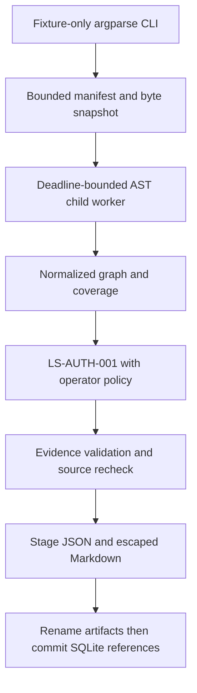

# 02 — System Architecture

> Team/platform update (2026-11-02): [team handoff](21_TEAM_HANDOFF.md), [finite next-phase plan](22_NEXT_PHASE_PLAN.md), and [current portability/publication evidence](23_PORTABILITY_AND_RELEASE_VERIFICATION.md) supersede earlier onboarding, remote-state and platform assumptions. Historical checks below retain their original date and scope.

## Integrated demo status — 2026-11-02

The approved [demo contract](16_DEMO_DELIVERY_CONTRACT.md) is implemented alongside the preserved first-slice analyzer: immutable hash-verified bundles, disabled/mock explanations with a gated Meta adapter, and a fixed React/Vite/TypeScript/Cytoscape viewer. See [capability gates](17_CAPABILITY_AND_RESEARCH_REPORT.md), [finite evaluation](18_DEMO_EVALUATION.md), and [integrated verification](19_INTEGRATED_DEMO_REVIEW.md) for current checks and review disposition. Document 14 remains historical first-slice evidence; its 73-test count is not the integrated total.

At this 2026-11-02 checkpoint, the recorded milestones were baseline `7797b85`, integrated demo `4f0346c`, and viewer refinement `2cda191`. The demo ran offline. The later [competition verification](../spec/06_COMPETITION_VERIFICATION.md) records the live Meta result, public Pages deployment, and separate controlled DATA, TRUST, and actor/action/resource reports. Fixed synthetic intake remains the supported scope.

## Implemented modular monolith

The implementation is a small Python package under `backend/src/lazarus_sentinel/`, not the earlier proposed layered API/frontend tree. `models.py` owns strict Pydantic envelopes; `intake.py` bounds reads; `worker.py` launches extraction; `analysis.py` extracts supported structure; `rules.py` evaluates declarations and validates evidence; `service.py` coordinates; `persistence.py` stores references; `report.py` renders; `cli.py` exposes the command. NetworkX MultiDiGraph supports graph queries with stable edge IDs.

The actual analyzer protocol is `CodeAnalyzer.analyze(snapshot: Snapshot) -> Graph`, with `name` and `version`. `Graph` contains repository metadata, nodes, edges, evidence, coverage, diagnostics and findings. Do not implement against the earlier speculative AnalysisRequest/AnalysisResult types.

Source identity is a content-manifest revision; Git metadata is not the authority. Exact bytes travel as base64 in the internal snapshot. Long-lived artifacts contain locations/hashes, not excerpts. The separate fixture oracle is never input to analysis.

## Scope and limits

AST call relationships describe supported syntax, not runtime reachability or value propagation. Endpoint dependencies are observed DEPENDS_ON declarations, not proof of authorization execution. Unknown scopes suppress findings and remain diagnostic. Process limits and sanitized environment do not isolate filesystem/network access at OS level.

Artifacts are uniquely staged and renamed, then their validated references and results are committed together in SQLite. A crash between rename and commit can leave orphan files; readers use committed references. Existing output symlink aliases are rejected, but concurrent hostile filesystem replacement is outside scope.

## Future architecture — proposed only

The broader three-layer thesis remains code structure + application architecture + security context. Joern/CodeQL/Semgrep adapters, data-flow facts, asset/identity models, a FastAPI service and verified live runtime access remain future increments. The fixed React/Cytoscape frontend and bounded explanation modules now consume separately validated exports; they do not alter the scanner. Joern remains NOT_ATTEMPTED rather than a failed adapter or required predecessor to AST.

LangGraph may replace linear coordination if measured state/concurrency requirements justify it. Provider integration must remain evidence-bounded and separately authorized. Neo4j, distributed workers, object storage, per-tenant services and runtime telemetry are not current requirements; revisit only against measured needs. No directories, interfaces or dependencies are promised by this roadmap.
